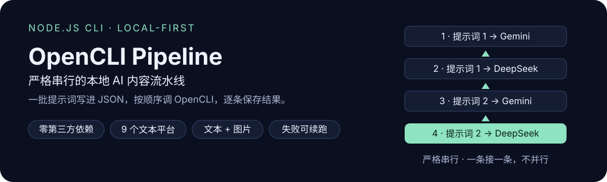

<p align="right"><a href="README.md">中文</a></p>

<p align="center">
  
</p>

<p align="center">
  <a href="https://xiaosang.cc/opencli-pipeline/">▶ Project Page</a>
  ·
  <a href="https://github.com/holynova/opencli-pipeline">GitHub Repository</a>
</p>

OpenCLI Pipeline (`ocp`, v0.1.0) is a local CLI workflow tool: write prompts and target platforms into a JSON file, and it calls OpenCLI in strict serial order, saving each text answer or image to disk separately. Strictly serial, never parallel; zero third-party npm dependencies, just Node.js 20+.

It never calls model APIs directly and never stores cookies, accounts, or passwords. Model login, membership, and generation quotas all come from the browser session OpenCLI connects to.

## What It Does

- **Batch prompts in strict serial order**: execution follows a fixed prompt × provider sequence (prompt 1 on Gemini, prompt 1 on DeepSeek, prompt 2 on Gemini, …).
- **Text mode**: choose multiple OpenCLI `ask` platforms; `providers: ["all"]` expands to 9 general web text platforms: ChatGPT, Gemini, Claude, DeepSeek, 豆包 (Doubao), Grok, Kimi, 千问 (Qwen), 元宝 (Yuanbao).
- **Image mode**: ChatGPT or Gemini only; images download straight to the local run directory (each call uses its own project directory, so nothing lands in the default downloads folder).
- **Per-platform options**: each platform can set timeout, model, deep thinking, image ratio, style, and other options OpenCLI supports (passed through).
- **Preflight checks**: verify OpenCLI, the Browser Bridge, and account state before running; guide each un-logged-in platform through web login.
- **Complete records**: every call keeps its prompt, raw response, error log, final result, and a run summary; after a failure, only the failed items need retrying.

## Prerequisites

1. Node.js 20 or higher.
2. OpenCLI installed, passing the browser-bridge check.
3. Web login completed on each platform you plan to use, with the corresponding text or image generation eligibility.

```bash
node --version
opencli --version
opencli doctor
```

This project has no third-party npm dependencies. For development, just run `node bin/ocp.js` directly; to put `ocp` on the current shell's path, run `npm link` in the project directory.

## Quick Start

```bash
# 1. See the platforms OpenCLI has discovered on this machine
node bin/ocp.js providers

# 2. Create or edit your own pipeline from an example
cp examples/text-pipeline.json my-pipeline.json

# 3. Validate the config only — generates nothing
node bin/ocp.js validate my-pipeline.json

# 4. Check the Browser Bridge and account state
node bin/ocp.js preflight my-pipeline.json

# 5. Open the official login page for un-logged-in platforms
node bin/ocp.js login my-pipeline.json

# 6. Run serially, output to runs/
node bin/ocp.js run my-pipeline.json
```

Command help: `node bin/ocp.js help`, or `node bin/ocp.js help run` / `help login` / `help preflight` / `help init`.

## Creating a Pipeline

Interactive creation (asks for mode, platforms, and prompts in turn; enter prompts one per line, an empty line ends input):

```bash
node bin/ocp.js init --out pipeline.json

# Or read prompts from a file (one per line)
node bin/ocp.js init --mode text --providers gemini,deepseek \
  --prompts-file prompts.txt --out pipeline.json
```

Text-mode example (see `examples/text-pipeline.json`):

```json
{
  "version": 1,
  "name": "article-outline",
  "mode": "text",
  "providers": [
    { "id": "gemini", "timeoutSeconds": 180, "options": { "model": "2.5-flash" } },
    { "id": "deepseek", "options": { "model": "expert", "think": true } }
  ],
  "prompts": [
    { "id": "outline", "text": "为一篇介绍 AI 工作流的文章写一个五段式大纲。" },
    { "id": "title", "text": "为这篇文章给出五个中文标题。" }
  ],
  "options": { "timeoutSeconds": 120, "continueOnError": true, "siteSession": "ephemeral" }
}
```

See `examples/image-pipeline.json` for image mode (Gemini image options such as `rt: "16:9"`, `st: "watercolor"`); `examples/all-text-providers.json` demonstrates `providers: ["all"]`.

### Config Fields

| Field | Meaning |
|---|---|
| `version` | Always `1`. |
| `name` | A readable name for this run, used for the output directory. |
| `mode` | `text` or `image`. |
| `providers` | Platform name strings, or objects with per-platform settings. |
| `prompts` | Prompt list; each item needs a unique `id` and non-empty `text`. |
| `options.timeoutSeconds` | Global wait time in seconds. Text defaults to 120, image to 240. |
| `providers[].timeoutSeconds` | Overrides the global wait time for that platform. |
| `providers[].options` | Supported parameters passed through to that platform's OpenCLI command. |
| `options.continueOnError` | `true` logs failures and continues with later items; `false` stops safely. |
| `options.siteSession` | OpenCLI's web session policy. Keep the default `ephemeral` to avoid context leaking between prompts. |

`providers[].options` only accepts parameters OpenCLI exposes for that platform. Run `opencli <platform> <command> --help` to see what's available in the current version.

## Preflight & Login

Preflight sends no prompts — it only runs OpenCLI diagnostics, capability discovery, and site status queries:

```bash
node bin/ocp.js preflight pipeline.json
node bin/ocp.js preflight pipeline.json --json
node bin/ocp.js preflight pipeline.json --login   # Combine preflight and login
```

Status meanings: `yes` — logged in and ready; `no` — not logged in or in guest mode, runs will be refused; `unknown` — cannot confirm, open the login page or check the desktop app installation. Login guidance skips `yes` platforms:

```bash
node bin/ocp.js login pipeline.json
```

Platforms you've manually confirmed working can be explicitly allowed with `options.allowUnknownLogin` (only for confirmed platforms); `allowGuest` allows guest mode per platform, but guest features and quotas are up to the platform, so it's generally not recommended for batch production.

## Run Output

Every `run` creates a new directory and never overwrites old results:

```text
runs/20260718T150000-article-outline/
  pipeline.resolved.json
  prompts.jsonl
  manifest.json
  summary.md
  items/
    001-outline--gemini/
      request.json
      stdout.json
      stderr.log
      response.md
      result.json
    002-outline--deepseek/
      ...
```

- Text results are saved in `response.md`; image results go in the item's `images/` directory.
- `result.json` records the exit code, elapsed time, text or image file paths, and error info; `summary.md` summarizes all items in the run.
- You can specify the output root: `node bin/ocp.js run pipeline.json --out ./my-runs`.

## Failure, Stopping & Resume

`ocp` keeps OpenCLI's original stdout, stderr, and exit code. Even if OpenCLI exits 0, an item is marked failed if it produced no text or image file. After fixing account, network, or platform issues, resume from the run directory:

```bash
node bin/ocp.js resume runs/20260718T150000-article-outline
```

Items that already succeeded and whose outputs still exist won't call the model again; failed or unfinished items re-run.

## Tech

- Node.js 20+, ESM, zero third-party dependencies; a single CLI entry in `src/cli.js` (`bin/ocp.js` only forwards to it).
- Calls the `opencli` command via child processes (`ask` / `image` / `doctor`, …), parsing its output and exit code; lists local platforms dynamically from OpenCLI's capability discovery.
- Tests: `npm test` (`node --test`, 5 cases, verified passing locally), covering platform capability discovery, generation-free preflight, text ordering, image file detection, and command help; `test/fixtures/opencli.js` mocks OpenCLI.

```
bin/ocp.js              CLI entry (forwards to src/cli.js)
src/cli.js              All commands: init / providers / preflight / login /
                        validate / run / resume / help
examples/               text-pipeline.json / image-pipeline.json /
                        all-text-providers.json
test/ocp.test.js        5 cases (node --test)
test/fixtures/opencli.js  Mock OpenCLI (for tests)
```
