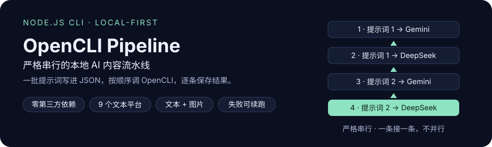

<p align="right"><a href="README.en.md">English</a></p>

<p align="center">
  
</p>

<p align="center">
  <a href="https://xiaosang.cc/opencli-pipeline/">▶ 项目主页</a>
  ·
  <a href="https://github.com/holynova/opencli-pipeline">GitHub 仓库</a>
</p>

OpenCLI Pipeline（`ocp`，v0.1.0）是一个本地命令行工作流工具：把多条提示词和目标平台写进一个 JSON 文件，它按顺序调用 OpenCLI，把每条文本回答或图片单独保存到本地。严格串行，不并行；零第三方 npm 依赖，只需 Node.js 20+。

它不调用模型 API，也不保存 Cookie、账号或密码。模型登录、会员资格和生成额度都由 OpenCLI 连接的浏览器会话提供。

## 能做什么

- **批量处理多条提示词，严格串行执行**：执行顺序固定为提示词 × 平台的笛卡尔顺序（提示词 1 的 Gemini、提示词 1 的 DeepSeek、提示词 2 的 Gemini……）。
- **文本模式**：可选择多个 OpenCLI `ask` 平台；`providers: ["all"]` 展开为 9 个通用网页文本平台：ChatGPT、Gemini、Claude、DeepSeek、豆包、Grok、Kimi、千问、元宝。
- **图像模式**：仅使用 ChatGPT 或 Gemini，图片直接下载到本地运行目录（每次调用用专属项目目录，避免混入默认下载目录）。
- **平台级选项**：每个平台可设置等待时间、模型、深度思考、图片比例和风格等 OpenCLI 已支持的选项（透传）。
- **运行前检查**：检查 OpenCLI、Browser Bridge 和账号状态；可逐个平台引导网页登录。
- **完整记录**：每条调用保留提示词、原始返回、错误日志、最终结果和运行汇总；失败后可只重试失败项。

## 前置条件

1. Node.js 20 或更高版本。
2. 已安装 OpenCLI，并通过浏览器桥接检查。
3. 在要使用的平台完成网页登录，并具备相应的文本或图像生成资格。

```bash
node --version
opencli --version
opencli doctor
```

本项目没有第三方 npm 依赖。开发时直接运行 `node bin/ocp.js` 即可；如需把 `ocp` 加入当前终端环境，在项目目录执行 `npm link`。

## 最短使用流程

```bash
# 1. 查看本机 OpenCLI 已发现的平台
node bin/ocp.js providers

# 2. 从示例创建或编辑自己的 Pipeline
cp examples/text-pipeline.json my-pipeline.json

# 3. 只检查配置，不会生成内容
node bin/ocp.js validate my-pipeline.json

# 4. 检查 Browser Bridge 和账号状态
node bin/ocp.js preflight my-pipeline.json

# 5. 为未登录的平台打开官方登录页
node bin/ocp.js login my-pipeline.json

# 6. 串行运行，输出到 runs/ 目录
node bin/ocp.js run my-pipeline.json
```

命令帮助：`node bin/ocp.js help`，或 `node bin/ocp.js help run` / `help login` / `help preflight` / `help init`。

## 创建 Pipeline

交互式创建（依次询问模式、平台和提示词，提示词逐条输入，空行结束）：

```bash
node bin/ocp.js init --out pipeline.json

# 也可从文件读取提示词（每行一条）
node bin/ocp.js init --mode text --providers gemini,deepseek \
  --prompts-file prompts.txt --out pipeline.json
```

文本模式示例（见 `examples/text-pipeline.json`）：

```json
{
  "version": 1,
  "name": "article-outline",
  "mode": "text",
  "providers": [
    { "id": "gemini", "timeoutSeconds": 180, "options": { "model": "2.5-flash" } },
    { "id": "deepseek", "options": { "model": "expert", "think": true } }
  ],
  "prompts": [
    { "id": "outline", "text": "为一篇介绍 AI 工作流的文章写一个五段式大纲。" },
    { "id": "title", "text": "为这篇文章给出五个中文标题。" }
  ],
  "options": { "timeoutSeconds": 120, "continueOnError": true, "siteSession": "ephemeral" }
}
```

图像模式示例见 `examples/image-pipeline.json`（Gemini 图片选项如 `rt: "16:9"`、`st: "watercolor"`）；`examples/all-text-providers.json` 演示 `providers: ["all"]`。

### 配置字段

| 字段 | 含义 |
|---|---|
| `version` | 固定为 `1`。 |
| `name` | 本次运行的可读名称，用于输出目录。 |
| `mode` | `text` 或 `image`。 |
| `providers` | 平台名字符串，或带平台级设置的对象。 |
| `prompts` | 提示词列表，每项必须有唯一 `id` 和非空 `text`。 |
| `options.timeoutSeconds` | 全局等待时间（秒）。文本默认 120，图片默认 240。 |
| `providers[].timeoutSeconds` | 覆盖该平台的全局等待时间。 |
| `providers[].options` | 透传给该平台 OpenCLI 命令的已支持参数。 |
| `options.continueOnError` | 为 `true` 时记录失败后继续后续项目；为 `false` 时安全停止。 |
| `options.siteSession` | OpenCLI 的网页会话策略。建议保留默认 `ephemeral`，避免提示词之间串上下文。 |

`providers[].options` 只能填 OpenCLI 对该平台公开的参数。运行 `opencli <平台> <命令> --help` 可查看当前版本可用的参数。

## 账号预检和登录

预检不发送提示词，只执行 OpenCLI 的诊断、能力发现和站点状态查询：

```bash
node bin/ocp.js preflight pipeline.json
node bin/ocp.js preflight pipeline.json --json
node bin/ocp.js preflight pipeline.json --login   # 合并预检和登录
```

状态含义：`yes` 已登录可运行；`no` 未登录或游客态，运行会被拒绝；`unknown` 无法确认，需打开登录页或检查桌面应用安装状态。登录引导会跳过 `yes` 平台：

```bash
node bin/ocp.js login pipeline.json
```

已手工确认可用的平台，可用 `options.allowUnknownLogin` 显式放行（仅对已确认的平台使用）；`allowGuest` 可按平台放行游客态，但游客功能和额度由平台决定，通常不建议用于批量生产。

## 运行结果

每次 `run` 都创建一个新的目录，不会覆盖旧结果：

```text
runs/20260718T150000-article-outline/
  pipeline.resolved.json
  prompts.jsonl
  manifest.json
  summary.md
  items/
    001-outline--gemini/
      request.json
      stdout.json
      stderr.log
      response.md
      result.json
    002-outline--deepseek/
      ...
```

- 文本结果保存在 `response.md`；图片结果保存在对应项目的 `images/` 目录。
- `result.json` 记录退出码、耗时、文本或图片文件路径和错误信息；`summary.md` 汇总这次运行所有项目。
- 可指定输出根目录：`node bin/ocp.js run pipeline.json --out ./my-runs`。

## 失败、停止和恢复

`ocp` 保留 OpenCLI 的原始 stdout、stderr 和退出码。即使 OpenCLI 返回退出码 0，只要没有产生文本或图片文件，项目也会标为失败。修复账号、网络或平台问题后，用运行目录恢复：

```bash
node bin/ocp.js resume runs/20260718T150000-article-outline
```

已经成功且产物仍在的项目不会再次调用模型；失败或未完成的项目会重新执行。

## 技术

- Node.js 20+，ESM，零第三方依赖；单一 CLI 入口 `src/cli.js`（`bin/ocp.js` 仅转发）。
- 通过子进程调用 `opencli` 命令（`ask` / `image` / `doctor` 等），解析其输出与退出码；用 `opencli` 的能力发现动态列出本机平台。
- 测试：`npm test`（`node --test`，5 个用例，本地实跑 5 通过），覆盖平台能力发现、无生成预检、文本顺序、图片文件判定和命令帮助；另有 `test/fixtures/opencli.js` 模拟 OpenCLI。

```
bin/ocp.js              CLI 入口（转发到 src/cli.js）
src/cli.js              全部命令：init / providers / preflight / login /
                        validate / run / resume / help
examples/               text-pipeline.json / image-pipeline.json /
                        all-text-providers.json
test/ocp.test.js        5 个用例（node --test）
test/fixtures/opencli.js  模拟 OpenCLI（供测试用）
```
